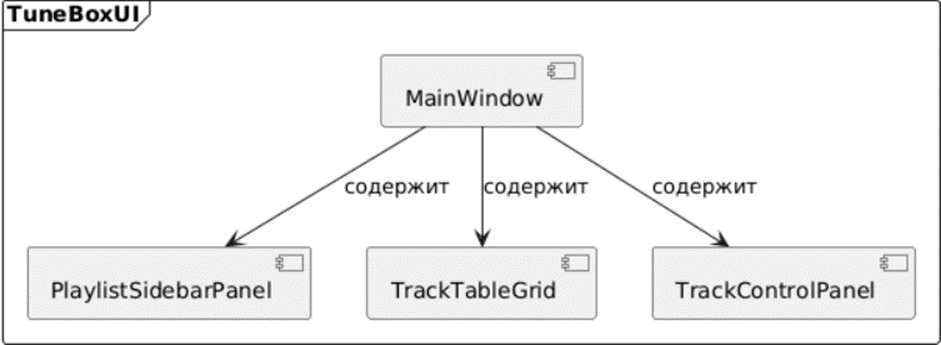
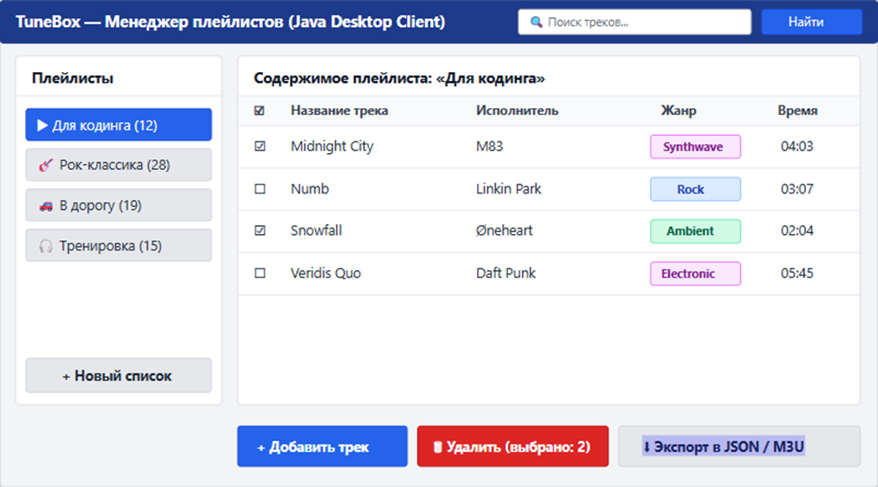

# Спецификация требований к ПО (SRS) — TuneBox (Менеджер плейлистов)

## 1. Введение и бизнес-цели
**TuneBox** — десктопное приложение на языке Java для локальной систематизации музыкальных коллекций, создания пользовательских плейлистов, фильтрации метаданных треков и экспорта списков воспроизведения.

## 2. Границы проекта (Scope)
Приложение управляет списками воспроизведения и карточками треков (название, исполнитель, жанр, длительность), но не является аудиоплеером и не воспроизводит звуковые потоки.

## 3. Прототипирование интерфейса
### 3.1 Структурная схема компонентов (SysMLv2)

### 3.2 Визуальный UI-мокап

## 4. Функциональные требования
- **FR-1:** Создание, переименование и удаление пользовательских плейлистов.
- **FR-2:** Добавление и удаление метаданных трека (название, исполнитель, жанр, длительность).
- **FR-3:** Поиск треков по подстроке и фильтрация по музыкальному жанру.
- **FR-4:** Экспорт выбранного плейлиста во внешний файл.

## 5. Нефункциональные требования
- **NFR-1:** Отклик пользовательского интерфейса при фильтрации таблицы до 100 мс.
- **NFR-2:** Интуитивно понятный интерфейс в темной цветовой теме.
- **NFR-3:** Работа на платформе Java (JDK 17+) и локальное хранение данных в формате JSON.
